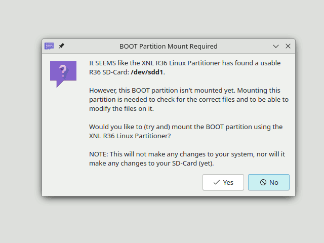

# Archived Status (24-10-2026)
This project is now officially archived and will no longer be updated nor supported!
It was (is) intended for use with ArkOS, and I no longer use ArkOS/dArkOS so I'm not able to keep maintaining this (simple) script/tool anymore either. 

I no longer use ArkOS/dArkOS and thus will not be able to support or update this project anymore, I'm currently actively working on my own distro specifically designed and optimized for the R36 (from scratch), and thus it's for me impossible to keep track of all ArkOS (now dArkOS) changes in the future, and to be very honest; I'm also not really up to it/'in the mood' to keep doing it for a project I no longer use myself for various reasons (NOTHING bad about ArkOS/dArkOS! it just does not fit my needs and doesn't do exactly what I want to do with it).
IF Anyone else does want to keep maintaining this project for other ArkOS/dArkOS users on the R36 for example, then you are of course free (AND WELCOME!) to fork the project and continue the project 😊, do obviously respect the GPL license and keep the credits as you should 😊
Thanks you all for a GREAT time ArkOS, but it's time to move on to bigger things now 😉 

# XNL R36 Linux Partition Sizer (Linux Version)
This is the source code of the [XNL R36 Linux Partition Size](https://www.teamxnl.com/r36-linux-partition-sizer/).  

This Linux version has basically been (nearly) completely rewritten in C++ (while using Qt for the GUI) to step away from the platform dependent mess with my projects😉

This program makes it increddibly easy for standard users to assign additional storage space to the Linux/ArkOS partition of their R36S/R36H. This tool NEEDS to be used directly after flashing the ArkOS image to your SD-Card, and thus before inserting (and booting) the SD-Card for the first time in the R36S/R36H. 

More information about this process, why and how it works can yet again be found on the official website (which is listed above).  

Here is a small GIF Demo of the XNL R36 Linux Partition Sizer and the result (Running On Kubuntu 24.04LTS with KDE Plasma Breeze Light):  
  
NOTE: Color artifacts in this 'demo gif' are of course due to the compression of the gif file.

# IMPORTANT NOTE
This source code is NOT intended to be forked, re-distributed or to be used for "slightly alternative versions". It is intended for edcuational purposes, to give you the oppertunity to look at what my application is doing, or to use (parts of) it to make your own version of a program like this from <strong>scratch</strong>. The reason for this simply put is that this tool doesn't do 'that much of a special thing', it simply puts just edits one plain-text-script (sh), and changes one value in it. And that "proccess" just has been given a "nice jacket" for users to make that process a bit more streamlined for beginners. I just want to prevent that the internet gets cluttered with dozens of forks of this program with either just small to even no modifications. Resulting in nothing more than dozens of out-dated versions in the end, and thus regular users possibly getting confused on which version they will need or not (and that would defeat the entire purpose of this application 😉). And considering that the "thing" this application does is basically ridicilously simple, it's just useless to have a bucket full of forks from this repository on GitHib😉😂  
  
The entire explanation, license etc can be found on the official website of the [XNL R36 Linux Partition Size](https://www.teamxnl.com/r36-linux-partition-sizer/), There (and in the source code comments) you'll also find information on how/when you <strong>are</strong> allowed to (re-)use this source code for your own version 😊  
  
I hope that you'll understand and respect my decission to release the source-code with these limitations.  

